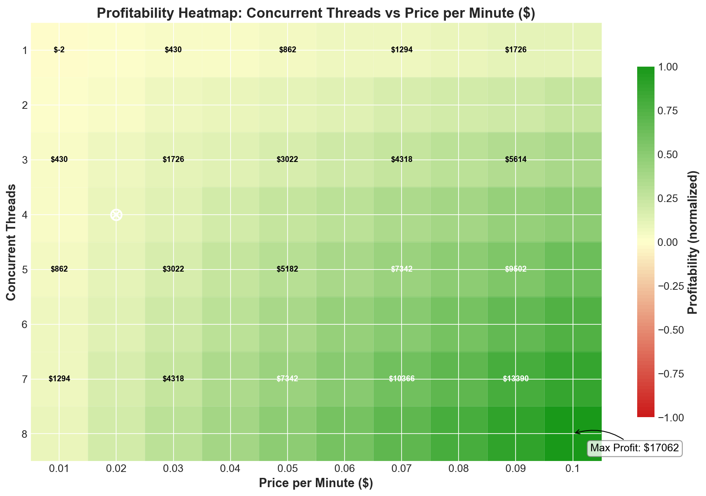

# Infra-Calc

Model the economics of serving an LLM locally. Infra-Calc estimates revenue,
hardware depreciation, electricity and maintenance from configurable operating
assumptions. Its browser calculator compares scenarios, and the Python driver
generates price frontiers, heatmaps and GPU comparisons.



```sh
uv sync --locked
uv run --locked python run.py
```

[Documentation](docs/README.md) · [Model and assumptions](docs/model.md) · [Software manuscript](docs/manuscript/README.md)

[License](LICENSE) · [Citation](CITATION.cff)
